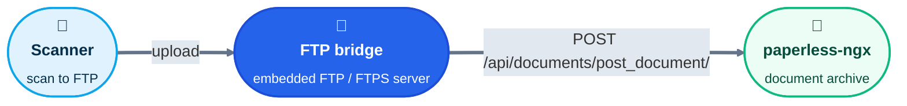

<div align="center">

# 📠 → 📄 paperless-ngx FTP bridge

**Point your scanner at an FTP address. Get the document in paperless-ngx. Nothing in between.**

[](https://github.com/taskmedia/paperlessngx-ftp-bridge/releases)
[](https://github.com/taskmedia/paperlessngx-ftp-bridge/actions/workflows/test-go.yaml)
[](#license)
[](https://artifacthub.io/packages/helm/taskmedia/paperlessngx-ftp-bridge)


</div>

---

## What is this?

Many document scanners can only "scan to FTP". [paperless-ngx](https://docs.paperless-ngx.com/) wants documents through its API or a consume folder. This bridge closes the gap: it **is** the FTP server, and every file that lands on it is pushed straight to the paperless-ngx API.



| Feature | What you get |
|---|---|
| 🚫 **No second FTP server** | Nothing to run, mount or keep in sync. The bridge speaks FTP itself. |
| ⚡ **Instant** | The document is posted to paperless-ngx the moment the transfer finishes. |
| 💾 **No disk** | Uploads are buffered in memory and never persisted. Runs with a read-only root filesystem. |
| 🔐 **FTPS built in** | Explicit FTPS (`AUTH TLS`) is always on. Self-signed by default, or bring your own cert. |
| 👥 **Multiple accounts** | One env var per FTP user, e.g. one per scanner. |
| ☸️ **Kubernetes-ready** | Separate liveness and readiness endpoints, locked-down container, multi-arch image. |

## Quick start

```bash
docker run --rm \
  -p 2121:2121 -p 50000-50019:50000-50019 -p 8080:8080 \
  -e PAPERLESS_URL=https://paperless.example.com \
  -e PAPERLESS_USER=bridge \
  -e PAPERLESS_PASSWORD=change-me \
  -e FTP_ACCOUNT_scanner=scanner-password \
  -e FTP_PASV_PUBLIC_HOST=192.168.1.10 \
  -e FTP_PASV_PORT_MIN=50000 \
  -e FTP_PASV_PORT_MAX=50019 \
  ghcr.io/taskmedia/paperlessngx-ftp-bridge-image:latest
```

Then configure the scanner:

| Setting | Value |
|---|---|
| Protocol | FTP or FTPS (explicit) |
| Host | `192.168.1.10` (your `FTP_PASV_PUBLIC_HOST`) |
| Port | `2121` |
| User / password | `scanner` / `scanner-password` |
| Mode | Passive |

> [!IMPORTANT]
> `FTP_PASV_PUBLIC_HOST` must be the address the **scanner** can reach. Without it, passive mode breaks behind NAT or inside a container.

## Configuration

All configuration is via environment variables.

| Variable | Required | Default | Description |
|---|:---:|---|---|
| `PAPERLESS_URL` | ✅ | | Base URL of your paperless-ngx instance |
| `PAPERLESS_USER` | ✅ | | paperless-ngx user (HTTP basic auth) |
| `PAPERLESS_PASSWORD` | ✅ | | Password for that user |
| `FTP_ACCOUNT_<USERNAME>` | ✅ | | Adds an FTP account. The variable suffix is the username, the value is the password. Repeat for more accounts. Usernames must be letters, digits or `_`. |
| `FTP_PASV_PUBLIC_HOST` | ⚠️ | `localhost` | Address advertised to clients for passive data connections, and the SAN of the self-signed cert |
| `FTP_PASV_PORT_MIN` / `FTP_PASV_PORT_MAX` | | ephemeral | Port range for passive data connections. Set it when you need to publish ports. |
| `FTP_LISTEN_ADDR` | | `:2121` | FTP control channel listen address |
| `FTP_ALLOWED_EXTENSIONS` | | `.pdf` | Comma-separated allowlist, case-insensitive, e.g. `.pdf,.png,.jpg` |
| `PAPERLESS_CHECK_INTERVAL_SECONDS` | | `60` | How often the background paperless-ngx reachability check runs |
| `LOG_LEVEL` | | | Log verbosity |

### TLS

Explicit FTPS is always offered next to plain FTP; there is no switch.

- **Default:** a self-signed ECDSA P-256 certificate is generated in memory at startup. It changes on every restart.
- **Your own cert:** mount a `kubernetes.io/tls` style pair (`tls.crt`, `tls.key`) at `/etc/ftp/tls`. It is picked up automatically, and renewals (e.g. from cert-manager) are reloaded without a restart.

### Health endpoints

Served on port `8080`.

| Endpoint | Meaning | Fails when | Kubernetes should |
|---|---|---|---|
| `/healthz` | Liveness | The FTP listener is no longer accepting connections | restart the pod |
| `/readyz` | Readiness | The listener is down **or** paperless-ngx is unreachable | stop routing, but not restart |

## Deploy on Kubernetes

The Helm chart lives in [taskmedia/helm](https://github.com/taskmedia/helm), not in this repository:

- Source: [`charts/paperlessngx-ftp-bridge`](https://github.com/taskmedia/helm/tree/main/charts/paperlessngx-ftp-bridge)
- Upgrade notes: [`docs/MIGRATION.md`](https://github.com/taskmedia/helm/blob/main/charts/paperlessngx-ftp-bridge/docs/MIGRATION.md)
- Issues and pull requests for the chart: [taskmedia/helm](https://github.com/taskmedia/helm/issues)

```bash
helm repo add taskmedia https://helm.task.media
helm repo update

helm show values taskmedia/paperlessngx-ftp-bridge > my-values.yaml
$EDITOR my-values.yaml

helm upgrade --install paperlessngx-ftp-bridge taskmedia/paperlessngx-ftp-bridge --values my-values.yaml
```

The chart is also published as an OCI artifact on [ghcr.io](https://ghcr.io/):

```bash
helm upgrade --install paperlessngx-ftp-bridge oci://ghcr.io/taskmedia/paperlessngx-ftp-bridge
```

The chart exposes the control port and the passive range (default `50000`-`50019`) through a single `LoadBalancer` service, and pins `replicas: 1` on purpose.

## Good to know

- **Uploads only.** Downloads, resume, append and delete are not supported. Files exist only long enough to be forwarded.
- **Flat by design.** If a scanner uploads into subfolders, the folders are accepted and ignored. Only the file name reaches paperless-ngx.
- **One replica.** Passive data connections must hit the same pod as the control connection.
- **Allowlist.** Anything outside `FTP_ALLOWED_EXTENSIONS` is rejected.

## Development

```bash
make lint   # golangci-lint
make test   # go test -v -cover ./...
```
## License

MIT. See the image label in the [Dockerfile](Dockerfile).
